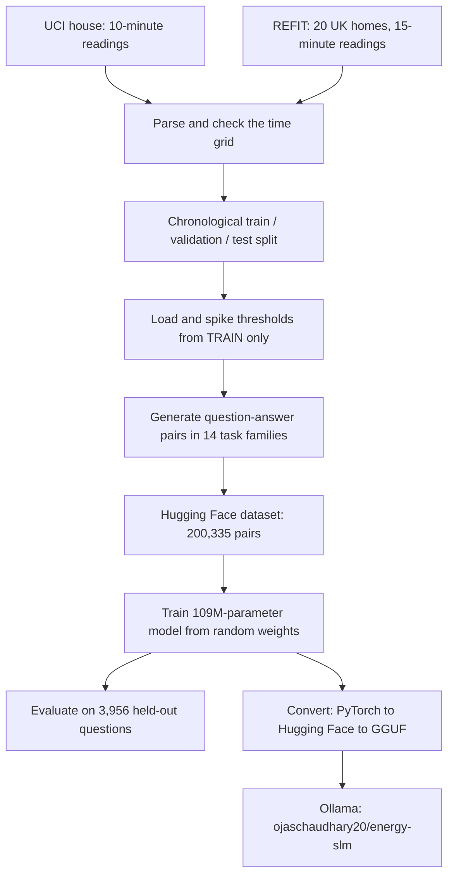
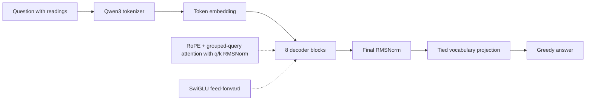
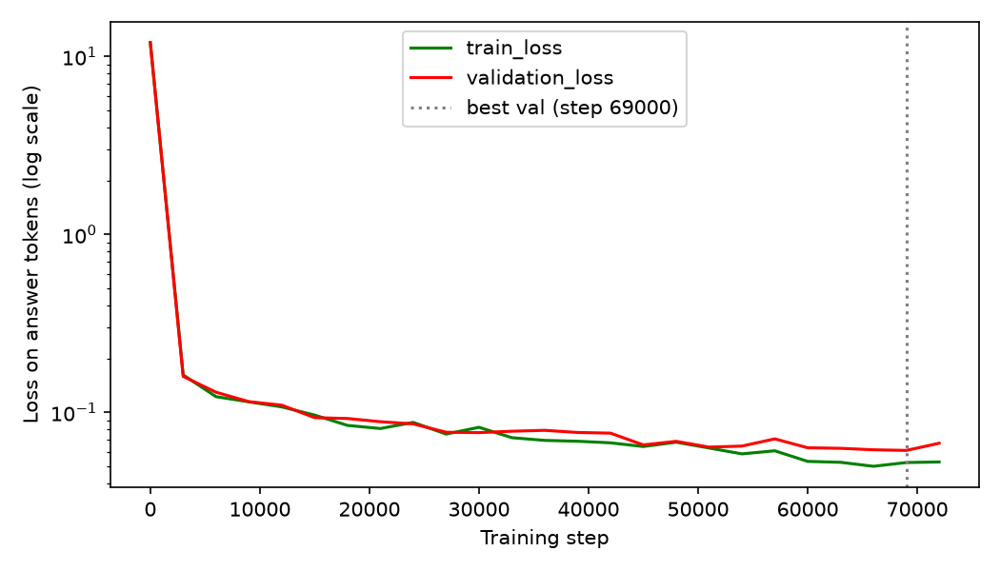

# Smart-Home Energy SLM
### From-scratch 109M-parameter Qwen3-architecture Transformer for household electricity readings, public on Ollama

[](https://ollama.com/ojaschaudhary20/energy-slm)
[](https://huggingface.co/Design-Thinking-SLM/smart-home-energy-qwen3-scratch)
[](https://huggingface.co/datasets/Design-Thinking-SLM/smart-home-energy-slm)
[](https://creativecommons.org/licenses/by/4.0/)

**Team:** Ojas Chaudhary (Leader), Parameswar Sahoo, Omsai, Nandhakishore. Jain University, Design Thinking course (25ESHS01), guided by Dr. Sujeet S. Jagtap.

**Latest project milestone (20 November 2026):** The model has been trained **from random weights**, evaluated on 3,956 held-out questions, converted to GGUF, and **published** as [`ojaschaudhary20/energy-slm`](https://ollama.com/ojaschaudhary20/energy-slm). It answers short questions about household electricity readings (costs, load levels, spikes, short-horizon forecasts) and says **"cannot be determined"** when the meter data cannot answer.

> **Scope:** This is a course prototype, **not** a general chatbot and not a tool for billing, forecasting or safety decisions. "Low", "moderate", "high" and "peak" are percentiles of each house's own training data, not an official standard.

## Run the public model with Ollama

Install [Ollama](https://ollama.com/download), then run:

```bash
ollama run ojaschaudhary20/energy-slm
```

The same weights, prompt template and settings can be run from Hugging Face:

```bash
ollama run hf.co/Design-Thinking-SLM/smart-home-energy-qwen3-scratch
```

The download is 379 MB. Paste a question worded like the dataset's:

```text
Electricity costs €0.35 per kWh. At 2016-05-18 13:20 the appliances used 90 Wh in 10 minutes. What did that interval cost?
```

Answer from the published model:

```text
90 Wh = 0.090 kWh, and 0.090 × €0.35 = €0.0315.
```

Type `/bye` to leave. More questions that are known to work are in [docs/demo_questions.md](docs/demo_questions.md). Each question is answered on its own: only the latest message is sent to the model.

### Project milestones

| Phase | Contribution | Current status |
|---|---|---|
| **1. Data engineering** | UCI + REFIT readings; chronological splits; train-only thresholds; 200,335 question–answer pairs | Published dataset |
| **2. From-scratch SLM** | 109M-parameter Qwen3-architecture decoder trained from random weights | Published on Hugging Face |
| **3. Evaluation** | 3,956 held-out questions with confidence intervals and paired tests | Answers and scores in [`results/`](results/README.md) |
| **4. Ollama deployment** | Weight-preserving GGUF export, prompt template, signed-out pull test | **Publicly available** |

## Repository and published artifacts

| Artifact | Location | Contents |
|---|---|---|
| Source code | [Ojas1004/design_thinking_slm_project](https://github.com/Ojas1004/design_thinking_slm_project) | Data generator, training notebook, evaluation, export scripts |
| Ollama model | [ojaschaudhary20/energy-slm](https://ollama.com/ojaschaudhary20/energy-slm) | GGUF (float16), prompt template, parameters, licence |
| Hugging Face model | [smart-home-energy-qwen3-scratch](https://huggingface.co/Design-Thinking-SLM/smart-home-energy-qwen3-scratch) | `transformers` weights, GGUF, original checkpoint, model card |
| Dataset | [smart-home-energy-slm](https://huggingface.co/datasets/Design-Thinking-SLM/smart-home-energy-slm) | `large` (UCI + REFIT, 200,335 pairs) and `default` (UCI only, 33,916 pairs) |
| Evaluation evidence | [results/](results/README.md) | Every test answer, config and loss curve for both training runs |
| Design-thinking sheets | [docs/](docs) | Problem framing, persona, How-Might-We, roles, business model canvas |

## System overview



---

# Phase 1: Data Validation and Question Generation

This phase is **deterministic data engineering**. Code computes every reference answer; no language model writes the training data.

## 1.1 Source data

| Source | What | Licence |
|---|---|---|
| [UCI Appliances Energy Prediction](https://archive.ics.uci.edu/dataset/374/appliances+energy+prediction) (Candanedo et al. 2017) | One Belgian house, 19,735 ten-minute readings, 2016-01-11 to 2016-05-27: appliance energy (Wh), lights, 9 temperature/humidity pairs, weather | CC BY 4.0 |
| [REFIT](https://doi.org/10.1038/sdata.2016.122) (Murray et al. 2017), via [`Jainam03/RESCAST-100k-REFIT`](https://huggingface.co/datasets/Jainam03/RESCAST-100k-REFIT) | 20 UK homes, 1,044,201 fifteen-minute whole-house readings, 2013–2015 | CC BY 4.0 |

The UCI file is in `data/`. The generator downloads REFIT the first time it runs, into `data/refit_data/`.

## 1.2 What the data audit found

Each finding led to a rule in the generator. The full analysis is in [docs/problem_framing_answers.md](docs/problem_framing_answers.md).

| Finding | Consequence for the corpus |
|---|---|
| Readings are Wh per 10 minutes, so 60 Wh means 360 W | Wh-vs-kW trap questions |
| Load is heavy-tailed (median 60 Wh, max 1,080 Wh; top 10% of readings hold 38% of the energy) | Percentile levels and robust spike checks |
| `T6` is an outdoor sensor (r = 0.97 with `T_out`); `rv1`/`rv2` are random noise | Trap questions about misleading channels |
| No labels for occupancy, appliances, faults or tariffs | Explicit "cannot be determined" questions |
| One house, winter to spring only | REFIT homes added for the load-only tasks |

## 1.3 Chronological train/validation/test split

| Split | UCI period | REFIT period | UCI pairs | REFIT pairs | Total |
|---|---|---|---:|---:|---:|
| Training | to 2016-04-20 | to 2015-01-31 | 79,734 | 68,629 | **148,363** |
| Validation | to 2016-05-08 | to 2015-03-31 | 13,679 | 10,055 | **23,734** |
| Held-out test | after that | after that | 14,259 | 13,979 | **28,238** |
| **Total** | | | 107,672 | 92,663 | **200,335** |

No context window crosses a split boundary or a gap in the time grid.

## 1.4 Load levels from training-only percentiles

For the UCI house, each 10-minute reading falls in one of four bands:

| Level | Reading | Percentile of the training split |
|---|---:|---|
| low | up to 60 Wh | at or below the median |
| moderate | above 60, below 210 Wh | below the 90th |
| high | 210 Wh to below 340 Wh | at or above the 90th |
| peak | 340 Wh or more | top 5% |

Each REFIT home has its own thresholds, written into the question as a "house profile" line.

## 1.5 Question–answer generation

There are 14 task families. REFIT has only whole-house load, so it contributes to six of them.

| Group | Task families | Sources |
|---|---|---|
| Forecasting | `forecast_next`, `forecast_hour` | UCI, REFIT |
| Load statistics | `window_stats`, `daily_profile`, `spike_check` | UCI, REFIT |
| Dates and times | `time_features` | UCI, REFIT |
| Levels and units | `level_classify`, `units_cost` | UCI |
| Rooms and weather | `room_compare`, `outdoor_weather`, `lights_activity` | UCI |
| Honesty and traps | `unanswerable`, `false_premise`, `noise_features` | UCI |

**A refusal pair from the training split:**

```text
At Friday 26 February 2016 at 14:40: Appliances=40 Wh, lights=0 Wh, T1=20.9 °C, RH_1=37.7 %
Was anyone home?
```

Target:

```text
That cannot be determined from this data. It has no occupancy, motion or CO2 sensor. Temperature, humidity and energy can change for many reasons, such as weather, heating schedules or appliances on timers, so any answer would be a guess.
```

## 1.6 Dataset integrity and reproducibility

- **Answers come from the prompt.** Except in the two forecast tasks, whose reference is the reading that actually followed, every answer is computed from evidence in the question and the fixed train-only thresholds.
- **No leakage.** Thresholds use the training split only, and an assertion checks that no prompt appears in two splits.
- **Balanced and unique.** Yes/no questions are sampled 50/50, prompts are de-duplicated, and a prompt that maps to two answers is dropped.
- **Seeded.** A rerun reproduces these files byte for byte:

| File | SHA-256 |
|---|---|
| `energydata_sml_large_train.jsonl` | `7e0e06ca7c1b60c18472a75c5275f43806151f7bae4c7ee774c61dce07c60aaa` |
| `energydata_sml_large_val.jsonl` | `ad8c647573c5144c31ce9b9365b5d62fc4752e41b2e803c39c2ed74091b946a7` |
| `energydata_sml_large_test.jsonl` | `19004cec87437f00708437aa23dace54d38cb35851d80ebf2ca2037dbcd5928d` |

To generate the corpus (after the setup in [section 2.4](#24-reproduce-the-training)):

```bash
cd notebooks && jupyter nbconvert --to notebook --execute --inplace energydata_to_sml_jsonl.ipynb && cd ..
```

---

# Phase 2: From-Scratch Small Language Model

## 2.1 Trained from random weights

The model is the course's reference Qwen3-architecture notebook, adapted to this data. **No pretrained weights were loaded**; only the `Qwen/Qwen3-8B` tokenizer was borrowed. The first cell of [the training notebook](notebooks/5_slm_from_scratch_qwen.ipynb) lists every change from [the reference](notebooks/reference/5_slm_from_scratch_qwen.original.ipynb).

| Model property | Value |
|---|---:|
| Parameters | **109,121,536** |
| of which token embeddings | 77.7M |
| Vocabulary | 151,669 |
| Decoder layers | 8 |
| Width / feed-forward width | 512 / 2,048 |
| Attention heads / key-value groups | 8 / 4 |
| Context length | 448 tokens |
| Output projection | Tied to the input embedding |

Ollama reports 187M parameters because the exported file stores the input and output embedding tables separately (see [section 4.1](#41-conversion)).

## 2.2 Model structure



## 2.3 Training setup

| Field | Value |
|---|---|
| Loss | Cross-entropy on answer tokens only |
| Optimiser | AdamW, learning rate 3e-4 with 300 warm-up updates, cosine decay to 3e-5 |
| Batch | 8, with 4 gradient-accumulation steps |
| Steps | 72,000 |
| Best validation loss | **0.0611** at step 69,000 (the published checkpoint) |
| Hardware and time | RTX 5060 Laptop GPU (8 GB), about 97 minutes, at most 4.6 GB of GPU memory |



## 2.4 Reproduce the training

Run every command from the repository root. Generated data and models go to `data/` and `out/`, which git ignores.

```bash
uv venv --python 3.12 .venv && source .venv/bin/activate      # fish: source .venv/bin/activate.fish
uv pip install torch --index-url https://download.pytorch.org/whl/cu128
uv pip install -r requirements.txt
```

Generate the corpus (section 1.6), then train:

```bash
cd notebooks && jupyter nbconvert --to notebook --execute --inplace 5_slm_from_scratch_qwen.ipynb && cd ..
```

This writes the checkpoint, loss curve, test scores and an `hf_export/` folder to `out/qwen3_scratch/`. There is no need to retrain to use the model: the weights are on Hugging Face.

---

# Phase 3: Evaluation

## 3.1 Protocol

Up to 200 test questions per (task, source) group, 3,956 in total, answered with greedy decoding. **Exact match** requires the whole answer to equal the reference. The first version of the model, trained on the UCI-only corpus, answered the same questions, so the comparison is paired.

## 3.2 Headline results

| | First version (UCI only) | Published model (UCI + REFIT) |
|---|---:|---:|
| Exact match, UCI house (n = 2,356) | 61.2% | **69.0%** (95% CI 67.1–70.9) |
| Exact match, REFIT homes (n = 800) | 7.8% | **43.1%** (95% CI 39.7–46.6) |
| Unanswerable questions answered anyway | 0 of 364 | **0 of 364** |
| Answerable questions refused | 0 of 3,592 | **0 of 3,592** |

The improvement is significant on both sources (exact McNemar test, p < 10⁻³³ on UCI and p < 10⁻⁸⁰ on REFIT).

## 3.3 Results by task

| Task | UCI | REFIT |
|---|---:|---:|
| `false_premise` | 100.0% | – |
| `level_classify` | 100.0% | – |
| `lights_activity` | 100.0% | – |
| `noise_features` | 100.0% | – |
| `unanswerable` | 100.0% | – |
| `units_cost` | 95.5% | – |
| `time_features` | 87.5% | 61.5% |
| `room_compare` | 46.5% | – |
| `spike_check` | 38.5% | 45.0% |
| `window_stats` | 37.0% | 51.5% |
| `outdoor_weather` | 25.0% | – |
| `daily_profile` | 5.0% | 14.5% |

n = 200 per cell, except `level_classify` (156). Confidence intervals are in the [model card](https://huggingface.co/Design-Thinking-SLM/smart-home-energy-qwen3-scratch).

**Errors are mostly arithmetic:** 82% of wrong answers have the right wording with a wrong number.

## 3.4 Forecasts compared with persistence

Exact match does not apply to forecasts. Mean absolute error in Wh, against repeating the last value:

| Forecast | Source | Model | Persistence |
|---|---|---:|---:|
| Next reading | UCI | 28.4 | 31.8 |
| Next reading | REFIT | 39.4 | 33.4 |
| Next-hour total | UCI | 185.4 | 195.5 |
| Next-hour total | REFIT | 202.4 | 189.4 |

**The forecasts are no better than persistence.** None of the four 95% bootstrap intervals shows the model ahead, and on the next REFIT reading it is slightly worse (+6.0 Wh, 95% CI +0.4 to +12.1).

## 3.5 Free-form and adversarial prompts

[docs/positive_negative_prompts.md](docs/positive_negative_prompts.md) holds 12 legitimate and 12 adversarial prompts written outside the training templates. The model has seen no general English, so most of them produced unrelated or broken text, and three adversarial ones ended in a repeat-limit error in Ollama. The zero-hallucination result in section 3.2 therefore applies **only to questions in the dataset's wording**. A real deployment needs an input filter in front of the model.

## 3.6 Reproduce the evaluation

```bash
python scripts/export_qwen3_to_hf.py
python scripts/evaluate_full.py out/qwen3_scratch/hf_qwen3 out/qwen3_scratch/eval_full.jsonl 200
```

To recompute the statistics from the stored answers without retraining, follow [results/README.md](results/README.md).

---

# Phase 4: Ollama Conversion and Public Release

## 4.1 Conversion

Ollama runs GGUF files, and Ollama 0.40 on Linux cannot import safetensors folders, so [`export_hf_to_gguf.py`](scripts/export_hf_to_gguf.py) writes the GGUF directly with the `gguf` package:

```bash
python scripts/export_qwen3_to_hf.py       # notebook checkpoint -> Hugging Face Qwen3
python scripts/export_hf_to_gguf.py        # -> GGUF, 379 MB
ollama create energy-slm -f Modelfile
```

The notebook scales token embeddings by √512, which Hugging Face Qwen3 does not do. The converter folds that scale into a separate input embedding. The converted model's logits match the original to within 1.5 × 10⁻⁵.

## 4.2 Prompt template and settings

| Setting | Value | Why |
|---|---|---|
| Template | Only the latest user message | The model was trained on single questions |
| `temperature` | 0 | Same greedy decoding as the evaluation |
| `num_ctx` | 512 | Ollama setting; the model itself has a 448-token context |
| `num_predict` | 200 | Caps the answer length |
| `stop` | `<\|im_end\|>`, `<\|im_start\|>` | Ends the answer at the turn marker |

## 4.3 Release checks

| Check | Result |
|---|---|
| Pull into an empty, signed-out Ollama on the same machine | Succeeded |
| Template, parameters and licence in the published model | Present |
| One test question per (task, source) group, published model | 10/20 exact, the same as the local model |
| Same check on the Hugging Face copy | 10/20 exact |

The 10/20 check confirms that publishing changed nothing. It includes forecasts, which rarely match exactly, and is **not** an accuracy figure; use section 3.2 for that. To repeat it:

```bash
python scripts/check_ollama.py ojaschaudhary20/energy-slm data/energydata_sml_large_test.jsonl
```

---

# Design Thinking and Engineering Decisions

| Stage | Project-specific action |
|---|---|
| **Empathize** | Persona of the engineer who maintains a home-hub assistant and traces wrong answers back to the data ([sheet](docs/Empathy%20Map%20%26%20User%20Persona.md)) |
| **Define** | Five data problems: number tokenisation, heavy-tailed peaks, missing labels, misleading channels, one house ([sheet](docs/problem_framing_answers.md)) |
| **Ideate** | How-Might-We statements on context, tokenisation and training objective ([sheet](docs/How%20Might%20We%20Statement.md)) |
| **Prototype** | Question generator, from-scratch training, GGUF export, Ollama model |
| **Test and iterate** | The UCI-only model overfitted and failed on other homes, so the corpus was extended with 20 REFIT homes and the model retrained |

# Repository Layout

```text
design_thinking_slm_project/
├── README.md
├── Modelfile                              # Ollama recipe for the from-scratch model
├── requirements.txt
├── data/
│   ├── energydata_complete.csv            # Raw UCI readings
│   └── positive_negative_prompts.jsonl    # Legitimate and adversarial prompts
├── notebooks/
│   ├── energydata_to_sml_jsonl.ipynb      # Phase 1: question-answer generator
│   ├── 5_slm_from_scratch_qwen.ipynb      # Phase 2: from-scratch training
│   ├── data_conversion.ipynb              # First pipeline, superseded
│   └── reference/                         # Course notebook and the first (UCI-only) run
├── scripts/
│   ├── evaluate_full.py                   # Phase 3: answer the test questions
│   ├── analyze_eval.py                    # Phase 3: statistics
│   ├── make_article_figures.py            # Data and loss figures
│   ├── export_qwen3_to_hf.py              # Phase 4: checkpoint -> Hugging Face
│   ├── export_hf_to_gguf.py               # Phase 4: Hugging Face -> GGUF
│   └── check_ollama.py                    # Phase 4: one test question per task
├── results/                               # Configs, loss curves and every test answer
├── docs/                                  # Design-thinking sheets, dataset card, demo questions
├── convert_to_hf.py                       # Parquet conversion of the original corpus
└── train.py, chat.py, Modelfile.lora,     # Side experiment: LoRA baseline
    scripts/merge_lora.py
```

Model weights are hosted on Hugging Face and Ollama, not in this repository.

## Limitations and future work

- **Dataset wording only:** casual questions produce broken text, and the test questions use the same templates as training, on later dates.
- **Arithmetic is unreliable:** on `window_stats`, accuracy falls from 54% with fewer than 20 numbers in the question to 26% with 40 or more. Cost questions can fail with new prices (it once gave 0.120 × €0.30 = €0.0376 instead of €0.0360).
- **Derived values can be wrong:** weekdays, and the warmest or coldest room.
- **Short memory:** it sees only the last 3–12 readings for a forecast, not the same time yesterday or last week.
- **Narrow data:** room, weather and lighting questions come from one Belgian house over winter and spring. REFIT adds 20 UK homes, but only whole-house load.
- **Inefficient vocabulary:** 77.7M of 109M parameters are the Qwen3 embedding table, and its tokenizer splits numbers into single digits.
- **Strict scoring, one run:** an answer off by 10 Wh counts as wrong, and each model was trained once with one seed.

**Future work:** compute sums, dates and weekdays in code and let the model explain the result; add an input filter; give the model daily and weekly lags; use a smaller vocabulary; train several seeds; test new wordings and unseen homes.

## References

1. Candanedo, L. M., Feldheim, V., & Deramaix, D. (2017). Data driven prediction models of energy use of appliances in a low-energy house. *Energy and Buildings*, 140, 81–97. [doi:10.1016/j.enbuild.2017.01.083](https://doi.org/10.1016/j.enbuild.2017.01.083). Data CC BY 4.0.
2. Murray, D., Stankovic, L., & Stankovic, V. (2017). An electrical load measurements dataset of United Kingdom households from a two-year longitudinal study. *Scientific Data*, 4, 160122. [doi:10.1038/sdata.2016.122](https://doi.org/10.1038/sdata.2016.122). Data CC BY 4.0.
3. [Jainam03/RESCAST-100k-REFIT](https://huggingface.co/datasets/Jainam03/RESCAST-100k-REFIT), the REFIT copy the generator downloads.
4. [Qwen/Qwen3-8B](https://huggingface.co/Qwen/Qwen3-8B) (tokenizer only; pretrained weights not used).
5. [Ollama](https://ollama.com) and [GGUF](https://github.com/ggml-org/ggml/blob/master/docs/gguf.md).

---

**Summary:** **Phase 1** turns readings from one Belgian and 20 UK homes into 200,335 chronologically split question–answer pairs. **Phase 2** trains a 109M-parameter Qwen3-architecture model from random weights. **Phase 3** measures 69.0% (UCI) and 43.1% (REFIT) exact match, with no invented answers to the 364 unanswerable test questions. **Phase 4** publishes it as `ojaschaudhary20/energy-slm`.
